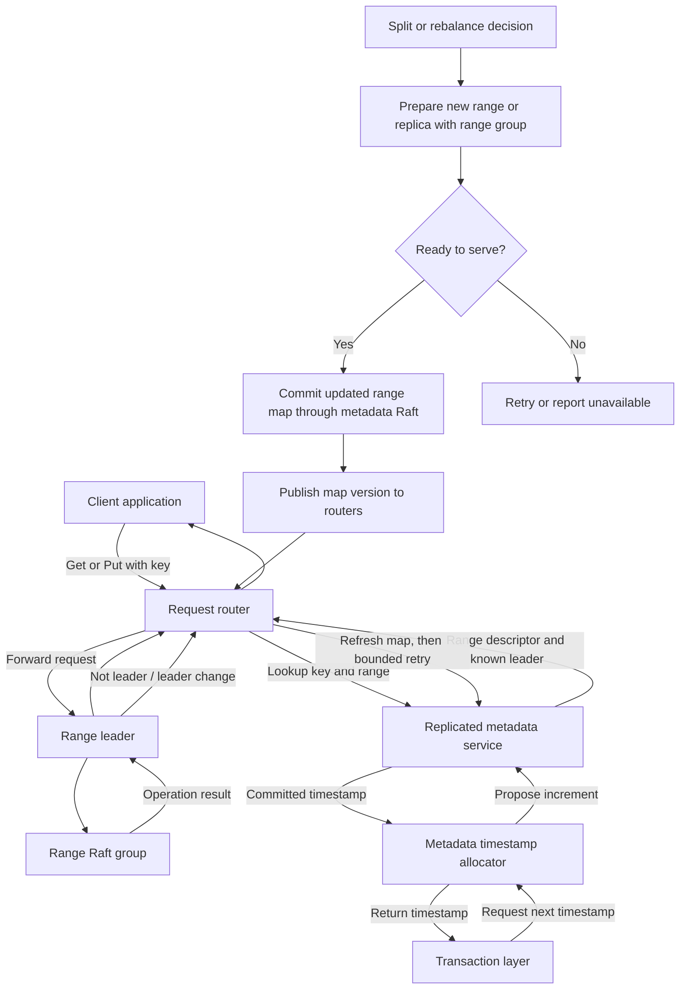

# Sharing & Metadata

Owner: Pranav

## Run this component

Everything needed to run Pranav's part is in this folder. Python 3.10 or newer is required; the current implementation uses only the standard library.

From the repository root, open two terminals and enter this folder in each:

```powershell
Set-Location -LiteralPath '.\2-Sharing&Metadata'
```

Start the backend in the first terminal:

```powershell
py -m backend.cmd.metadata
```

Start the frontend in the second terminal:

```powershell
py frontend/dev_server.py
```

Open the frontend at `http://127.0.0.1:5173`. The backend listens at `http://127.0.0.1:8080`; its default Raft address is `127.0.0.1:9090`. This default starts one metadata replica. See [URLs.md](URLs.md) for three-replica configuration and API examples.

## Folder layout

```text
2-Sharing&Metadata/
  backend/          Python metadata service and router
  frontend/         Browser UI and separate development server
  data/             Local SQLite files (ignored by Git)
  .gitignore        Local generated-file rules
  README.md         Component overview and run instructions
  TODO.md           Pranav's MVP checklist
  URLs.md           Current API reference
  EndProduct.md     Proposed finished-project API
```

The default database is `data/metadata/metadata.sqlite3` inside this folder. Relative `METADATA_DATA_DIR` settings are resolved from this folder; absolute paths are also supported. The frontend serves its own directory and proxies API calls to the backend.

| Component | Technology |
| --- | --- |
| Service and HTTP transport | Python standard library |
| Metadata replication | Metadata Raft group over HTTP |
| Durable state | SQLite with WAL and synchronous writes |
| Frontend | HTML, CSS, JavaScript, and a separate Python development server |

## What this part of the project does

Your part is the database's **control plane for key ranges**. It keeps the authoritative map of which range owns each key and which Raft replica currently leads that range. The router consults this map to send client operations to the right place. The metadata service also coordinates changes to that map when ranges split or replicas move, and allocates ordered timestamps for the transaction layer.

The range Raft groups store and replicate the actual key-value data. The metadata service stores information *about* those groups: range boundaries, replica membership, and known leaders.

## Main request flow

1. A client sends a key-value request to the router.
2. The router looks up the key in the range map and finds the range's current leader.
3. The router forwards the request to that range leader. The range's Raft group handles the operation and replicates writes as needed.
4. The result travels back through the router to the client.
5. If the node says it is no longer the leader, the router refreshes metadata and retries within a limit.

## Request routing interface

The Python backend looks up the range through a majority-backed metadata read, then sends the operation to the range leader configured in `RANGE_NODES`. The range service is expected to expose `POST /_range/execute` with the JSON contract documented in [URLs.md](URLs.md). The receiving range service is not implemented yet.

If a replica returns `NotLeader`, the router checks that the reported leader belongs to the range, updates the leader with the metadata version it read, and retries after refreshing the range map. Stale-metadata responses also trigger a fresh lookup. Each operation has a deadline and retry limit; unknown or unavailable leaders return a routing error. The router never sends a client operation to a node outside the range's replica list.

## Metadata changes

Range splits and replica movement change where keys live or which nodes host a range. The change should be prepared with the range group first. Once the new range layout or replica assignment is ready, the metadata service commits the new map through its replicated state machine. Routers then refresh their cached map. This avoids publishing a destination before it is ready to serve requests.

When a range elects a new leader, that information must reach the metadata service so future requests can be routed to the current leader. The exact notification/API contract will be coordinated with the Raft and API implementations.

## Timestamp flow

The transaction layer requests a timestamp from the metadata service. The metadata service advances its counter through its replicated state machine and returns the timestamp after the increment is committed. This gives concurrent callers an ordered timestamp source that can recover after a metadata-node restart.

## Flowchart



## Suggested implementation order

1. Define and validate the range descriptor and range map.
2. Implement metadata reads and replicated metadata updates, including range and leader information.
3. Implement key-to-range lookup and leader-aware routing, then test it with multiple ranges.
4. Add the replicated monotonic timestamp allocator.
5. Add range split and replica movement workflows, publishing metadata only when the destination is ready.
6. Document and test the integration points with the Raft, API, and transaction components.

## Integration boundaries

- The consensus and storage work supplies the Raft groups and durable state-machine application used by metadata and range groups.
- The API work supplies client-facing and inter-node request interfaces; the router uses those interfaces to forward requests.
- The transaction work consumes timestamps from the metadata allocator.
- This component owns range-map semantics, leader-aware routing decisions, metadata changes for splits and movement, and timestamp allocation.

The Python service and HTTP handler live under this folder's `backend/`; the metadata viewer lives under `frontend/`. The metadata state machine proposes changes through its own Raft group and stores the Raft log and applied state in SQLite. The HTTP and internal Raft interfaces are documented in [URLs.md](URLs.md).

See [TODO.md](TODO.md) for the implementation checklist.
