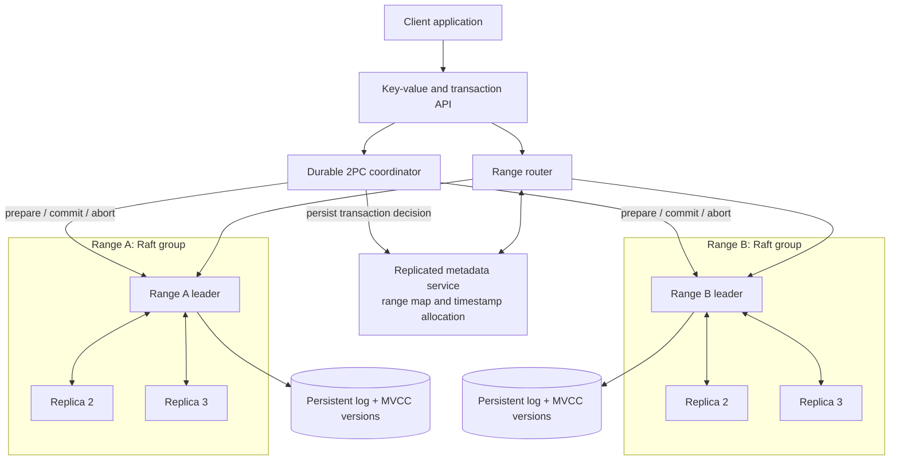

# Sharded, Strongly Consistent Distributed Key-Value Store

## Abstract

This project proposes a distributed key-value database that partitions keys into ranges and replicates each range with its own Raft consensus group (Multi-Raft). A metadata routing layer directs requests to the appropriate range leader and supports range splits and replica movement for horizontal scaling and shard balancing. Within a range, Raft provides leader election and durable log replication; quorum-backed reads and writes provide linearizable single-key operations while a majority of replicas is available. Multi-Version Concurrency Control (MVCC) keeps committed versions so transactions can read a consistent snapshot while other transactions write. For transactions spanning ranges, a durable coordinator uses two-phase commit (2PC) to record a single commit or abort decision across all participating Raft groups.

The prototype will demonstrate replication, leader failover, range routing, concurrent transactions, and atomic cross-range writes. We will evaluate throughput, read and write latency, failover time, transaction completion, and correctness during node crashes and network partitions. Transaction isolation behavior will be specified and tested as part of the implementation.

## Business Value

Applications such as inventory management, order processing, and account services need data that remains correct when servers fail. Partitioning key ranges lets the database distribute load and add capacity as data grows. Replication keeps a range available after a replica fails, provided its Raft group retains a majority. MVCC supports concurrent reads, while 2PC prevents a multi-range update from committing on only some ranges. Together, these capabilities reduce the need for application teams to build their own sharding, failover, and transaction recovery logic.

## A Proposed Architecture Diagram

Each range has three replicas and commits through a Raft majority. The metadata service stores the key-range map and allocates transaction timestamps; the router uses that map to find current leaders. Range splits and replica movement update the map as shards are balanced across nodes. For a cross-range transaction, the coordinator asks each participating leader to durably prepare; it then stores the final decision in the replicated metadata service before telling participants to commit or abort. After a crash, the coordinator replays that decision to finish any incomplete transaction. A range cannot accept new writes without a quorum, and prepared transactions may wait while the coordinator is unavailable.

## Repository Layout

- `backend/` contains the Python metadata service, SQLite state machine, Raft HTTP transport, and client API.
- `frontend/` contains the separate browser application and its Python development server.
- `2-SharingAndMetadata/URLs.txt` documents the API paths, inputs, responses, and current implementation status.

## Current Metadata Prototype Technology

| Component | Technology | Purpose |
| --- | --- | --- |
| Service implementation | Python 3.10+ | HTTP services and concurrency |
| Metadata consensus transport | Python standard-library HTTP | Raft vote and append RPCs between metadata replicas |
| Metadata persistence | SQLite in WAL mode with synchronous writes | Durable Raft log and applied range map |
| Frontend development server | Python standard library | Serves the browser UI separately and proxies API calls |

The current Python prototype covers the metadata control plane. Range Raft services, MVCC, transactions, Docker deployment, and evaluation tooling remain project work. See [URLs.txt](2-SharingAndMetadata/URLs.txt) for commands and endpoint details.

## MVP Scope: Raft and Durable Storage

The MVP is divided into four implementation parts:

### Part 1: Independent Raft state machines

Implement `go.etcd.io/raft/v3` so every key range owns an independent Raft state machine and replicated log.

**Status: Completed**

Implemented range descriptors, independent Raft groups, range-aware command routing, Raft election/heartbeat ticking, committed-command delivery, and tests for routing across independent ranges.

### Part 2: Pebble durable storage

Integrate Pebble to durably store the Raft log, hard state, and actual key-value records.

### Part 3: Single-group quorum operations

Ensure a single Raft group can elect a leader, replicate log entries to a quorum, and commit basic single-key reads and writes.

### Part 4: Crash recovery

Handle local node crash recovery by restoring Raft and key-value state from Pebble after restart.

