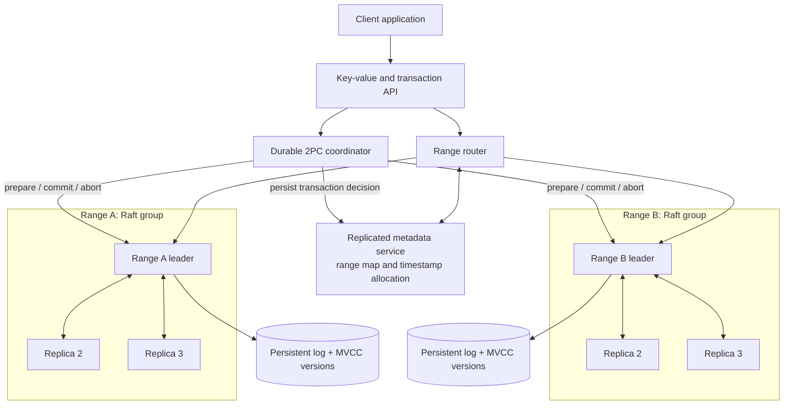

# Sharded, Strongly Consistent Distributed Key-Value Store

## Abstract

This project proposes a distributed key-value database that partitions keys into ranges and replicates each range with its own Raft consensus group (Multi-Raft). A metadata routing layer directs requests to the appropriate range leader and supports range splits and replica movement for horizontal scaling and shard balancing. Within a range, Raft provides leader election and durable log replication; quorum-backed reads and writes provide linearizable single-key operations while a majority of replicas is available. Multi-Version Concurrency Control (MVCC) keeps committed versions so transactions can read a consistent snapshot while other transactions write. For transactions spanning ranges, a durable coordinator uses two-phase commit (2PC) to record a single commit or abort decision across all participating Raft groups.

The prototype will demonstrate replication, leader failover, range routing, concurrent transactions, and atomic cross-range writes. We will evaluate throughput, read and write latency, failover time, transaction completion, and correctness during node crashes and network partitions. The initial transaction isolation target is **snapshot isolation**; serializable cross-range transactions are outside the initial scope.

## Business Value

Applications such as inventory management, order processing, and account services need data that remains correct when servers fail. Partitioning key ranges lets the database distribute load and add capacity as data grows. Replication keeps a range available after a replica fails, provided its Raft group retains a majority. MVCC supports concurrent reads, while 2PC prevents a multi-range update from committing on only some ranges. Together, these capabilities reduce the need for application teams to build their own sharding, failover, and transaction recovery logic.

## A Proposed Architecture Diagram

Each range has three replicas and commits through a Raft majority. The metadata service stores the key-range map and allocates transaction timestamps; the router uses that map to find current leaders. Range splits and replica movement update the map as shards are balanced across nodes. For a cross-range transaction, the coordinator asks each participating leader to durably prepare; it then stores the final decision in the replicated metadata service before telling participants to commit or abort. After a crash, the coordinator replays that decision to finish any incomplete transaction. A range cannot accept new writes without a quorum, and prepared transactions may wait while the coordinator is unavailable.

## Proposed Technology Used

| Component | Proposed technology | Purpose |
| --- | --- | --- |
| Service implementation | Go | Concurrency and network services |
| Inter-node communication | gRPC and Protocol Buffers | Typed APIs for routing, Raft transport, and transaction messages |
| Consensus | `go.etcd.io/raft/v3` | Separate Raft state machines for each key range and replicated metadata |
| Local storage | Pebble | Persistent Raft state and versioned key-value records |
| Deployment | Docker Compose | Reproducible multi-node development and failure experiments |
| Evaluation | Go tests and fault-injection scripts | Check transaction correctness, throughput, latency, and recovery under crashes and partitions |

